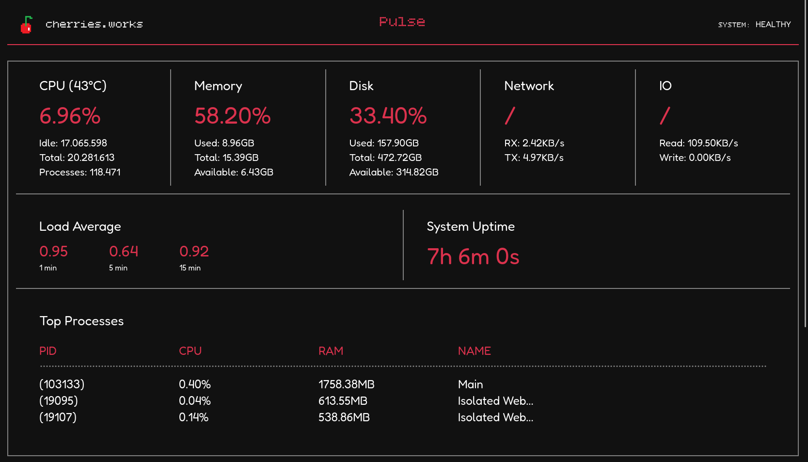
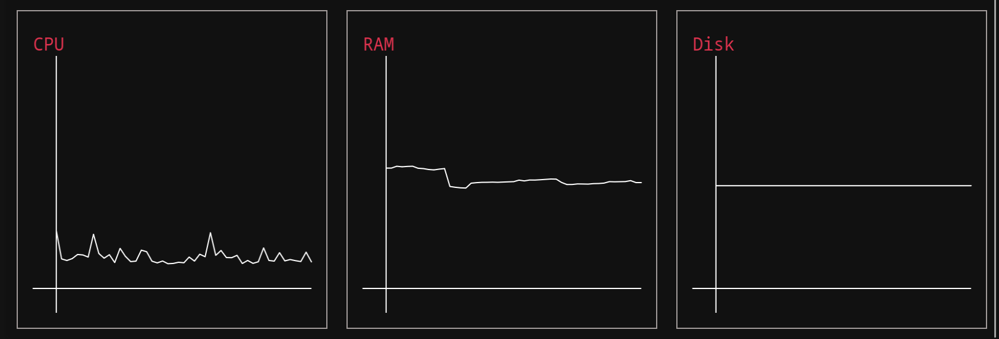

# Pulse

Lightweight Linux system monitoring, written in C.

A fast, simple, and efficient monitoring system that just works.

[Features](#features) · [Install](#installation) · [API](#api) · [Contributing](#contributing)

---

Pulse collects system metrics directly from Linux and exposes them through a minimal web dashboard. The simplicity, such as no accounts, or no setup is not a design flaw, its the goal of Pulse.

It reads everything from `/proc` and `/sys`, so there is nothing to install next to it. The HTTP server is written from scratch, serves a single lightweight page, and consumes little to no RAM.




## Table of Contents

1. [Features](#features)
2. [Installation](#installation)
3. [Running](#running)
4. [API](#api)
5. [Contributing](#contributing)
6. [Philosophy](#philosophy)
7. [Roadmap](#roadmap)
8. [License](#license)

## Features

- CPU usage
- Memory usage
- Disk usage
- Disk I/O statistics
- Network statistics
- Load averages
- Running processes, sortable by CPU and RAM
- Hostname and uptime
- Built-in web dashboard
- Historical metrics with graphs
- JSON API for everything the dashboard shows

## Installation

### Quick

```bash
$ curl -fsSL https://cherries.works/install/pulse.sh | sh
$ pulse
```

### Build from Source

```bash
$ git clone https://github.com/cherries-works/pulse.git
$ cd pulse
$ make
$ ./dist/pulse
```

Requires a C compiler and make. No other dependencies.

## Running

To start the dashboard, add the `--web` flag:

```bash
$ pulse --web
```

By default Pulse runs on:

```
http://localhost:8383
```

The port can be changed with `--port [number]`.

## API

All metrics are available as JSON, so Pulse works just as well as a data source for your own tooling as it does as a dashboard.

### Current metrics

```http
GET /api/metrics
```

Example response:

```json
{
  "error": null,
  "success": true,
  "timestamp": 1781131285,
  "cpu": {
    "idle": 9096832,
    "total": 9973308,
    "processes": 30307
  },
  "process_count": 250,
  "memory": {
    "available": 9560580,
    "total": 16141972
  },
  "disk": {
    "available": 70075166720,
    "total": 97574191104,
    "reads": 283625,
    "writes": 0
  },
  "network": {
    "rx": 195424940,
    "tx": 80206860
  },
  "load": {
    "load1": 1.87,
    "load5": 1.41,
    "load15": 1.17
  },
  "processes": [
    {
      "pid": 4503,
      "ram": 795660,
      "cpu": 10834,
      "name": "pulse"
    }
  ],
  "hostname": "cherries",
  "uptime": 14625
}
```

The `cpu.processes` value is cumulative since boot. The top-level `process_count` is the current number of running processes.

### Historical metrics

```http
GET /api/history/{cpu | ram | disk}
```

Example response:

```json
{
  "error": null,
  "success": true,
  "timestamp": 1783110731,
  "data": [
    {
      "timestamp": 1783110719,
      "usage": 13.801922
    },
    {
      "timestamp": 1783110721,
      "usage": 14.735517
    }
  ]
}
```

## Contributing

cherries.works is open source and contributions are welcome. Bug reports, feature ideas, and pull requests are all appreciated.

See [CONTRIBUTING.md](CONTRIBUTING.md) to get started. Good first issues are marked with the `good first issue` label.

## Philosophy

Pulse aims to be the simplest way to set up monitoring:

- Fast
- Lightweight
- Self-hosted
- Easy to deploy
- Low resource usage

See [PHILOSOPHY.md](docs/PHILOSOPHY.md) for more information.

## Roadmap

- Remote monitoring (`pulse remote`)
- Broader Notifications
- Official packaging
- Docker Build
- Network and disk throughput
- Support for more operating systems

## License

MIT

<br>
<br>
<br>

<p align="center">
  <b>
    Thanks for using Pulse.
  </b>
  <br>
  <br>
  
</p>  